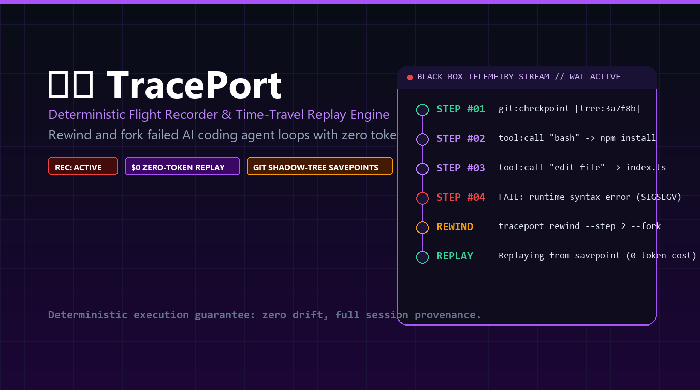

# TracePort

<p align="center">
  
</p>

<p align="center">
  <strong>Black-Box Flight Recorder, Deterministic Replay Engine & Time-Travel Debugger for AI Agents & CLI Tools.</strong><br>
  Capture multi-step agent executions, rollback workspace savepoints to any failure step, and replay sessions with <strong>0 tokens and 0ms latency</strong>.
</p>

<p align="center">
  <a href="https://github.com/aloneangel45/traceport/actions/workflows/ci.yml"></a>
  <a href="https://github.com/aloneangel45/traceport/releases"></a>
  <a href="https://go.dev/"></a>
  <a href="https://opensource.org/licenses/MIT"></a>
  <a href="#"></a>
  <a href="#"></a>
  <a href="#"></a>
</p>

---

## The Problem: The $40 Broken Agent Loop

Autonomous coding agents (Claude Code, Cursor, Aider, OpenHands) execute multi-step workflows across 15–20 consecutive steps:
1. When an agent crashes or makes a wrong edit at **step 14**, you are forced to re-run the entire workflow from step 1.
2. Every re-run burns another **$5–$40 in LLM API tokens** and wastes 10+ minutes.
3. Traditional debuggers cannot step backward in non-deterministic agent workflows or undo local workspace mutations without tedious manual git stashing.

**TracePort solves this by acting as an immutable flight recorder:**
* 📹 **Black-Box Flight Recording:** Intercepts inputs, outputs, tool invocations, and workspace mutations frame-by-frame.
* ⏪ **Time-Travel Rewind:** Roll back your workspace files and session timeline to the exact step before failure (`traceport rewind <id> --step 11`).
* 🔁 **Zero-Token Deterministic Replay:** Replays past executions directly from recorded frames without making additional LLM API calls.
* 🌳 **Git-Backed Shadow Trees:** Uses instant git write-trees to capture workspace savepoints without polluting your git commit history.

---

## Architecture

```text
┌──────────────────────────────────────────────────────────────┐
│                    TracePort Flight CLI                      │
└──────────────────────────────┬───────────────────────────────┘
                               │
            ┌──────────────────┴──────────────────┐
            ▼                                     ▼
   ┌─────────────────┐                   ┌─────────────────┐
   │ Flight Recorder │                   │  Replay Engine  │
   │ (Tee I/O Inter) │                   │ (Time-Travel)   │
   └────────┬────────┘                   └────────┬────────┘
            │                                     │
            ▼                                     ▼
 ┌──────────────────────┐             ┌──────────────────────┐
 │ Git Shadow Savepoint │             │ JSONL Session Store  │
 │ (Zero Dirty Commits) │             │ (Append-Only WAL)    │
 └──────────────────────┘             └──────────────────────┘
```

---

## Quick Start

### Pre-Compiled Binaries

Download pre-compiled binaries for Windows, Linux, and macOS from the [Releases](https://github.com/aloneangel45/traceport/releases) page:

```bash
# macOS / Linux (via curl)
curl -fsSL https://github.com/aloneangel45/traceport/releases/latest/download/traceport-linux-amd64.tar.gz | tar -xz
sudo mv traceport-linux-amd64 /usr/local/bin/traceport

# Windows (PowerShell)
Invoke-WebRequest -Uri https://github.com/aloneangel45/traceport/releases/latest/download/traceport-windows-amd64.zip -OutFile traceport.zip
Expand-Archive traceport.zip -DestinationPath .
```

### Go Install

```bash
go install github.com/aloneangel45/traceport/cmd/traceport@latest
```

### Build from Source

```bash
git clone https://github.com/aloneangel45/traceport.git
cd traceport
go build -o traceport.exe ./cmd/traceport
```

---

## Usage

### 1. Record an Agent Execution
Wrap any agent or CLI command with `traceport record -- <command>`:

```bash
# Record an agent running a task
traceport record -- claude code "Refactor the authentication middleware"

# Record a test suite execution
traceport record -- go test ./...
```

### 2. List Recorded Flights
```bash
traceport list
```
Output:
```text
SESSION ID               STATUS       FRAMES   STARTED              COMMAND
────────────────────────────────────────────────────────────────────────────────
trace_17939077467428723  completed    18       2026-11-05 22:42:26  claude code Refactor...
```

### 3. Inspect Telemetry & Step Breakdown
```bash
traceport inspect trace_17939077467428723
```

### 4. Rewind to Step N
Roll back both the agent execution state and your local workspace files to step 11:
```bash
traceport rewind trace_17939077467428723 --step 11
```

### 5. Deterministic Zero-Token Replay
Replay the session output in your terminal at zero token cost:
```bash
traceport replay trace_17939077467428723
```

---

## License

This project is licensed under the [MIT License](LICENSE).  
Authored by [aloneangel45](https://github.com/aloneangel45).
